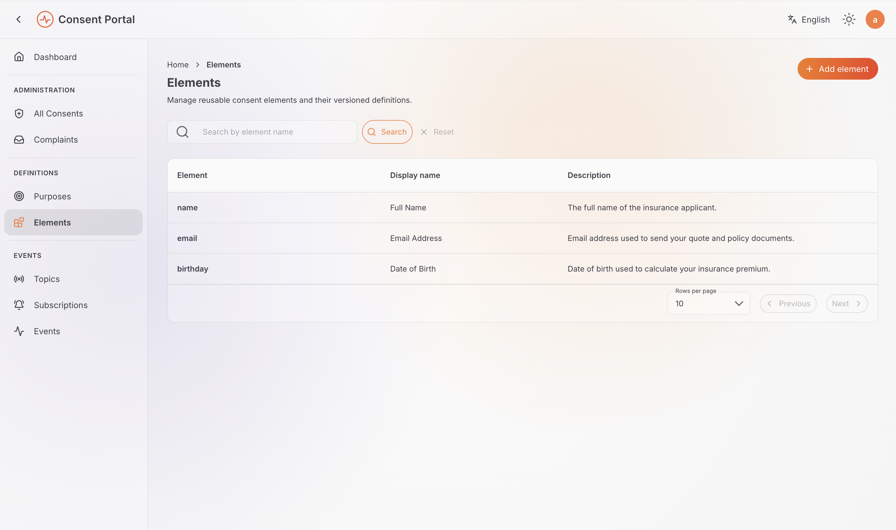
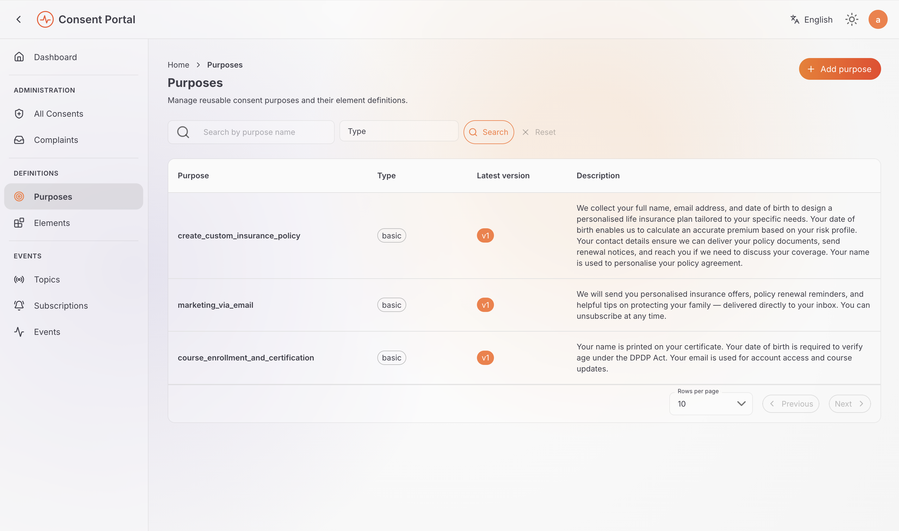

# Understanding Consent

Consent is not just about asking for a yes or no. It involves understanding what personal data is needed, why it is needed, and giving people control over how their data is used.

In practice, consent can change over time. People may give consent, update their preferences, or withdraw it altogether. Each of these decisions needs to be handled consistently throughout the consent lifecycle.

This guide uses a simple example to explain how consent works in the DPDP Accelerator, from defining data requirements and collecting consent to managing changes, handling withdrawals, and understanding who can manage each consent.

## Meet the people in this example

Throughout this guide, we'll use **CarePulse**, an online healthcare service, to explain how consent works in practice.

* **Priya** is the **Data Principal**. She uses **CarePulse** and decides whether to give, change, or withdraw consent for the use of her personal data.
* **CarePulse** is the **Data Fiduciary**. It determines why **Priya**'s personal data needs to be processed.
* **Anika** is **CarePulse**'s **Administrator**. She manages the catalog of Purposes and Elements and oversees consent records within **CarePulse**'s tenant.

## 1. Define what data is needed

Before **CarePulse** asks **Priya** for consent, it needs to define **what personal data it wants to use and for what purpose**. This helps **Priya** understand what she is agreeing to.

**Anika** sets this up in the catalog by defining the data elements and the purposes they support.

For example:

1. **Define the data element.** In **Elements**, **Anika** creates an element named `contact-email`, with a display name and description that explain what the data represents.

   

2. **Define the purpose.** In **Purposes**, she creates a purpose named `marketing-email`, with version `1.0`, and associates the `contact-email` element with it.

   

3. **Use the definition in a consent request.** **CarePulse** can now use this configuration to explain the purpose and the data involved when asking **Priya** for consent.

The key distinction is that **Elements and Purposes define what data is needed and why**, but they do not record anyone's consent. Creating an Element or Purpose alone does not mean **Priya** has agreed to anything.

The connected application or the Consent Management API uses these definitions to create an actual consent record when **Priya**'s consent is collected.

**Try it:** [Define a purpose and its data element](../try-out/consent.md#define-a-purpose-and-its-data-element).

## 2. Give consent and record the person's choices

### Present consent choices

Once **CarePulse** has defined its purposes and data requirements, its application can present the relevant consent choices to **Priya**.

The application can use the **Consent Management REST API** to retrieve the available Purposes and their associated Elements, present them to **Priya**, and submit her decisions to create consent records. This allows applications to integrate consent collection into their own user journeys.

For example, while booking a consultation, **Priya** might be asked to give consent for:

- Consultation-related processing
- Prescription delivery
- Optional wellness tips

**Priya** agrees to consultation-related processing and prescription delivery but declines wellness tips. **CarePulse** submits her choices through the Consent Management API to create a consent record reflecting her decisions.

### Record the purposes and data elements selected

A consent record captures the purposes **Priya** agreed to and the specific data elements covered by each purpose. It does not automatically include every element associated with a purpose.

For example, suppose **Priya** agrees to prescription delivery and provides her delivery address but chooses not to provide her optional phone number. The consent request includes only the delivery address element:

```json
{
  ...
  "purposes": [
    {
      "id": "<prescription-delivery-purpose-id>",
      "elements": [
        {
          "id": "<delivery-address-element-id>"
        }
      ]
    }
  ]
  ...
}
```

If **Priya** also agrees to share her phone number, **CarePulse** includes the phone number element ID in the same `elements` array.

The consent record also captures the version of the purpose used when the consent was created. This helps establish which version of the purpose the consent refers to.

### Review consent in the Consent Portal

After giving consent, **Priya** can open **My Consents** in the Consent Portal to review her consent records, including what she agreed to, which service requested the consent, its current status, and when it expires.

**Anika**, as **CarePulse**'s **Administrator**, can use **All Consents** to review tenant-wide consent records, subject to her permissions.

The Consent Portal allows individuals and administrators to review and manage consent records according to their roles.

**Try it:** [Review, authorize, revoke, and audit a consent](../try-out/consent.md#review-authorize-revoke-and-audit-a-consent).

## 3. Change or withdraw consent

Consent can change over time. A person may update their choices or decide to withdraw consent they previously gave.

For example, several weeks after booking her consultation, **Priya** decides she no longer wants to receive wellness messages. She opens **My Consents** in the Consent Portal, finds the relevant consent, and withdraws it.

The Consent Management API records the change, allowing the consent history to show:

- What changed
- When the change occurred
- Which purpose version was involved
- How the consent progressed through its lifecycle

### What happens after consent is withdrawn?

Withdrawing consent updates the consent record, but it does **not** automatically delete personal data already held by **CarePulse** or its Data Processors.

**CarePulse** must handle the consequences of the withdrawal according to applicable requirements, including stopping processing that relies on the withdrawn consent where required. Any necessary follow-up actions, such as notifying Data Processors or handling data under applicable retention requirements, depend on the relevant obligations and system integrations.

The Event Notifications feature can help **CarePulse** communicate consent changes to connected systems so they can take the appropriate action.

See [Event Notifications](event.md) for more information.

**Try it:** [Review, authorize, revoke, and audit a consent](../try-out/consent.md#review-authorize-revoke-and-audit-a-consent).

---

## Understanding consent states

A consent moves through a defined lifecycle. Its current state indicates whether it is awaiting a decision, in effect, or has been rejected, revoked, or expired.

| State | Meaning |
|---|---|
| `PENDING` | The consent is awaiting a decision from one or more required authorizers. |
| `ACTIVE` | The consent has received all required approvals and is in effect. |
| `REJECTED` | A required authorizer rejected the consent. |
| `REVOKED` | An active consent was withdrawn. |
| `EXPIRED` | The consent has reached its expiry time. |

### How does a consent become active?

The initial state depends on how the consent is configured:

- **No authorizers specified:** The consent becomes `ACTIVE` immediately.
- **One or more authorizers specified:** The consent starts as `PENDING` and becomes `ACTIVE` only after all required authorizers approve it.
- **An authorizer rejects a pending consent:** The consent becomes `REJECTED`.

## Three consent models

The accelerator supports three consent models based on who is involved in authorizing a consent: direct, delegated, and co-authorized consent.

### Direct consent

In direct consent, the subject gives consent for themself. No additional authorizers are required.

For example, Alice gives consent for the use of her own data:

```json
{
  "subjectId": "alice@wso2.com",
  "purposes": [
    {
      "id": "<purpose-id>",
      "elements": [
        {
          "id": "<element-id>"
        }
      ]
    }
  ]
}
```

Because no additional authorizers are specified, the consent becomes `ACTIVE` immediately.

Alice can manage her consent, including revoking it after it becomes active.

### Delegated consent

In delegated consent, one or more people authorize the use of data on behalf of the subject. This model is useful when a parent gives consent for a child or a guardian acts on behalf of a dependent.

For example, both parents may be required to approve a consent for their child:

```json
{
  "subjectId": "child@wso2.com",
  "purposes": [
    {
      "id": "<purpose-id>",
      "elements": [
        {
          "id": "<element-id>"
        }
      ]
    }
  ],
  "authorizations": [
    {
      "userId": "mother@wso2.com",
      "type": "USER"
    },
    {
      "userId": "father@wso2.com",
      "type": "USER"
    }
  ]
}
```

The consent remains `PENDING` until both parents approve it. If either parent rejects it, the consent becomes `REJECTED`.

In this model, the subject is an **observer only**. They can view the consent but cannot approve, reject, revoke, or otherwise manage it.

### Co-authorized consent

Co-authorized consent is useful when the subject must participate in the authorization decision alongside one or more other people.

For example, two joint account holders may both need to approve a consent, including the account holder identified as the subject.

```json
{
  "subjectId": "alice@wso2.com",
  "purposes": [
    {
      "id": "<purpose-id>",
      "elements": [
        {
          "id": "<element-id>"
        }
      ]
    }
  ],
  "authorizations": [
    {
      "userId": "alice@wso2.com",
      "type": "USER"
    },
    {
      "userId": "bob@wso2.com",
      "type": "USER"
    }
  ]
}
```

Because both Alice and Bob are authorizers, the consent remains `PENDING` until both approve it. If either rejects it, the consent becomes `REJECTED`.

Unlike delegated consent, the subject in a co-authorized consent is an active participant in the decision and can approve or reject the consent as an authorizer.

**Try it:** [Review, authorize, revoke, and audit a consent](../try-out/consent.md#review-authorize-revoke-and-audit-a-consent).

## Review and enforce consent before processing

Creating a consent record does not automatically ensure that an application uses personal data in accordance with that consent. Before processing personal data, the consuming application should verify that the consent is valid for the intended operation.

The application can retrieve the full consent record using the Consent Management REST API:

```http
GET /api/identity/consent-mgt/v2.0/consents/<consent-id>
```

The response provides information about the consent, including its current state, the purposes it covers, and the associated data elements.

For example, a consent response might include:

```json
{
  "id": "<consent-id>",
  "state": "ACTIVE",
  "purposes": [
    {
      "name": "marketing-email",
      "version": "1.0",
      "elements": [
        {
          "id": "<element-id>",
          "name": "contact-email",
          "displayName": "Contact email"
        }
      ]
    }
  ]
}
```

Before processing the data, the consuming application should check that:

- **The consent is active.** Its current state permits the intended processing.
- **The purpose matches.** The intended processing is covered by a purpose included in the consent.
- **The required data elements are covered.** The consent includes the specific data elements the application intends to use.

These checks help ensure that the application respects the person's recorded choices and does not rely on an earlier approval without verifying the consent's current state and scope.

## Next Steps

Now that you understand the consent lifecycle, try it yourself, or continue
to see what happens after a consent is revoked:

- [Define a purpose and its data element](../try-out/consent.md#define-a-purpose-and-its-data-element)
- [Review, authorize, revoke, and audit a consent](../try-out/consent.md#review-authorize-revoke-and-audit-a-consent)
- [Complaints](complaint.md) — see what happens when a Data Principal believes something went wrong despite their consent decision


